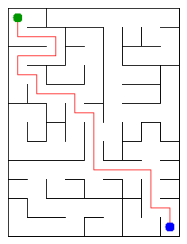

# Assignment 3. Maze Escape

Student ID: 252609
Name: Ramil Zhunussov
Group: SE-2510
Maze size (rows x columns): 12 x 9

This file is the report. Fill it in as you go. How to start: `START_HERE.md`. The task: `docs/Assignment3.pdf`.

## Program output

The 13 lines your program prints on your data (`java -cp out Main`):

    Broken: 107
    Kept: 88
    Last broken wall: 145
    MST cost: 32809
    Heaviest broken wall: 761
    Path length: 23
    DFS visited: 70
    Dead ends: 31
    Zones: 108
    Largest zone: 1
    Is DAG: 1
    Flow stages: 15
    Fastest route cost: 38

`java tools/Check.java`: the DSU checks pass and all 13 lines are right on `tiny`, `small` and `dag`.

My maze:

## Questions

Answer in your own words, two or three sentences each.

Mission 0. What do find and union do, and what makes them fast in your code?

`find(x)` walks from x up the parent links to the root, and the root is the name of the group. `union(a, b)` finds both roots and, if they are different, hangs the root of the smaller tree under the root of the larger one (union by size), so a tree never gets taller than log n. On the way up, `find` also re-hangs every cell of the path straight under the root (path compression), so the next `find` on those cells takes one step. Together this gives amortized O(α(n)) per operation, which is at most 4 or 5 for any real n. My `find` is a loop, not recursion, so a long chain cannot overflow the stack.

Mission 1. Why is Broken always R*C - 1, and Kept always (R-1)*(C-1)?

A wall is broken only when `union` returns true, so every broken wall joins two different groups and the broken walls never make a cycle. All neighbour walls of the grid are in the file and the grid is connected, so at the end all cells are one group: the broken walls are a spanning tree, and a tree on R*C cells has R*C - 1 edges (each successful union lowers the number of groups by one, from R*C down to 1). The grid has R*(C-1) horizontal-neighbour walls and (R-1)*C vertical-neighbour walls, together 2RC - R - C, so Kept = 2RC - R - C - (RC - 1) = RC - R - C + 1 = (R-1)*(C-1). For my maze: 12*9 - 1 = 107 and 11*8 = 88, out of 195 walls.

Mission 2. My MST cost from Kruskal and from Prim, and why they are equal:

Kruskal: 32809, Prim: 32809 (the heaviest broken wall is 761). Both algorithms only ever add the cheapest wall that crosses some cut between two groups of cells, and such a wall always belongs to a minimum spanning tree (the cut property). All costs in my file are different, so the minimum spanning tree is unique: both algorithms build the same tree, and so the cost is the same.

Mission 3. Why is there exactly one path between two cells? How did you avoid a stack overflow on a huge maze?

The open doors of the Mission 1 maze are a spanning tree. It is connected, so there is at least one path, and it has no cycle, so there is at most one: two different paths between the same two cells would together make a cycle. I wrote DFS without recursion: my own stack is an `int[]` of size n on the heap, and `dir[i]` remembers which of the four directions (up, right, down, left) cell `stack[i]` tries next. When the exit is marked, `stack[0..top]` is the path itself. I ran it on a 1000 x 1000 maze with `-Xss256k` (a small thread stack): it worked in about 0.1 s.

Mission 4. Why does the second pass of Kosaraju go on the reversed graph? Why do the slides have no cycle exactly when Zones equals the number of cells?

The cell that finishes last in the first pass lies in a source zone: no slide comes into that zone from another zone. A DFS from it on the normal slides could run out into other zones, but on the reversed slides it reaches only the cells that can slide *into* it, and for a source zone those are only the cells of the zone itself. So every DFS of the second pass collects exactly one zone; the next start is the remaining cell with the latest finish, which is a source of what is left, and that is also why the zone numbers come out in topological order. If the slides have a cycle, all cells on it reach each other and form one zone of at least 2 cells (there are no slides from a cell to itself), so Zones < n; if Zones = n, every zone is one cell, and a cycle is impossible because its cells would share a zone. My slides have 108 zones for 108 cells, so they are a DAG.

Mission 5. Why is it enough to go through the zones in the order of their numbers? What does this pass cost?

The zone numbers are a topological order: every slide between two zones goes from a smaller number to a larger one. So when the pass reaches zone X, every edge into X comes from a zone that was already processed, and the longest chain and the cheapest cost for X are final. We never have to come back to X, so a priority queue as in Dijkstra is not needed. Building the graph of zones goes once over the cells and the slides, and the pass looks at every zone once and every slide once, so it costs O(n + m) (Dijkstra would cost O(m log n)).

## Timing (Mission 7)

Milliseconds, 5 runs each, from `java -cp out Bench`.

| maze | Kruskal | Prim |
|---|---|---|
| 100 x 100 | 8 6 5 9 9, avg 7 | 11 4 3 3 3, avg 5 |
| 300 x 300 | 53 32 30 31 28, avg 35 | 45 45 42 40 76, avg 50 |
| 1000 x 1000 | 475 425 437 416 430, avg 436 | 1030 1015 1024 891 922, avg 976 |

What do the numbers say about how the time grows? Two or three sentences.

From 300 x 300 to 1000 x 1000 the number of cells and walls grows about 11 times; Kruskal grew 12.5 times and Prim about 20 times, so the time grows a little faster than linear, as O(m log m) predicts, and on the large maze the arrays no longer fit in the CPU cache, which adds more. Prim is about twice slower than Kruskal on 1000 x 1000: it does a heap operation on a `PriorityQueue<Integer>` for almost every wall and jumps around memory, while Kruskal sorts once and then does almost O(1) DSU operations. The 100 x 100 times are a few milliseconds and mostly show the JIT warming up, so they say little.

## Complexity

n is the number of cells, m the number of walls (or slides). Fill in every algorithm you wrote.

| algorithm | time | space | assumptions |
|---|---|---|---|
| DSU find and union | O(α(n)) amortized per operation | O(n) | union by size and path compression; `find` is a loop |
| Kruskal | O(m log m) | O(n + m) | sorting the walls dominates, then m DSU operations; it stops after n - 1 broken walls |
| Prim | O(m log m) | O(n + m) | lazy Prim with a binary heap (`PriorityQueue`); each wall enters the queue at most once |
| DFS | O(n + m) | O(n) | `Graphs.open` is O(n + m); the maze is a tree, so the DFS sees n - 1 doors, each cell has at most 4 neighbours |
| Kosaraju | O(n + m) | O(n + m) | two passes, each cell and each slide once per pass; lists of slides out and in |
| Route in the zone graph | O(n + m) | O(n + m) | zones are numbered in topological order; one pass, every slide relaxed once, no priority queue |

For a grid maze m is about 2n, so O(m log m) is the same as O(n log n).

## Before you submit

- data/walls.txt, data/slides.txt and output/maze.png are in the repository.
- `java tools/Check.java` shows all examples right.
- This README is filled in, the program output and the section AI use included.
- The work is pushed to main (at least one commit per mission) and the repository is public.
- The link is attached in Moodle.
